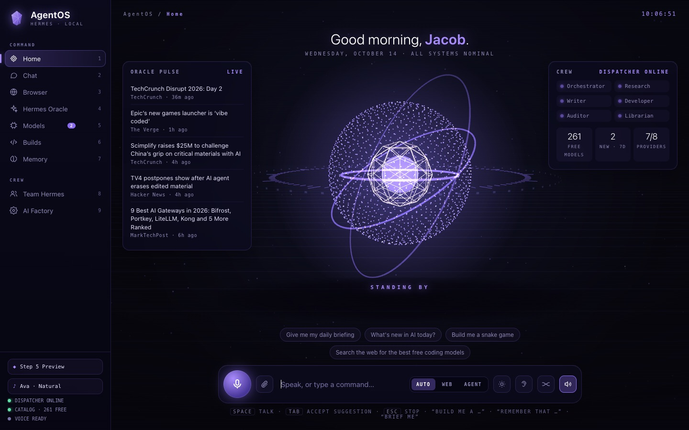
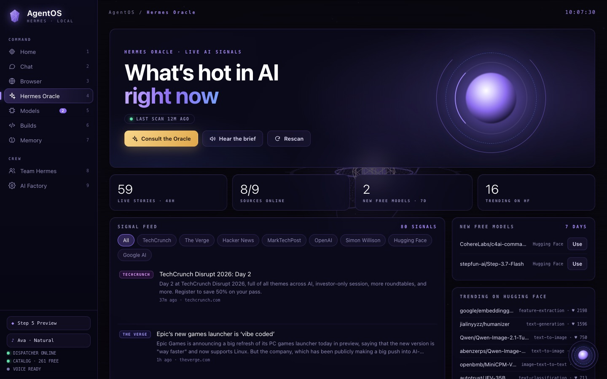
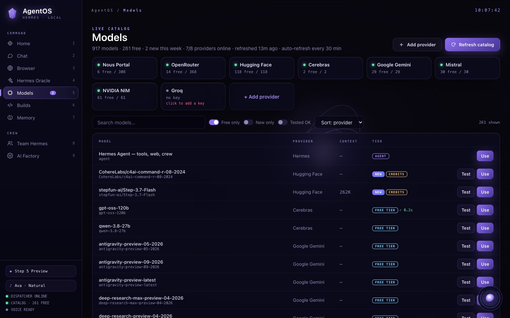
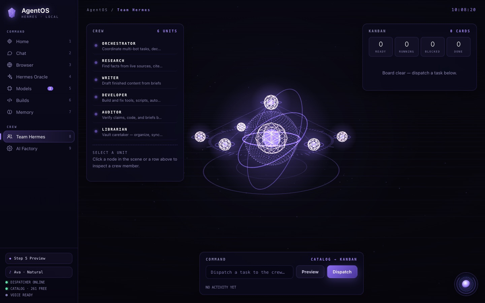
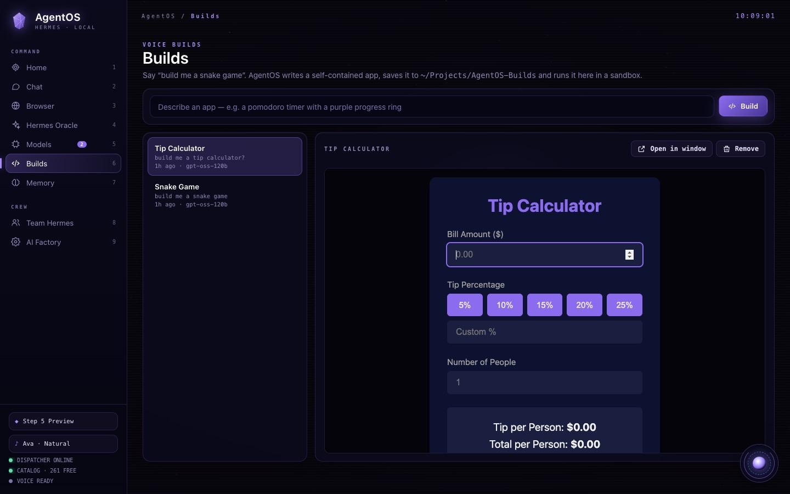
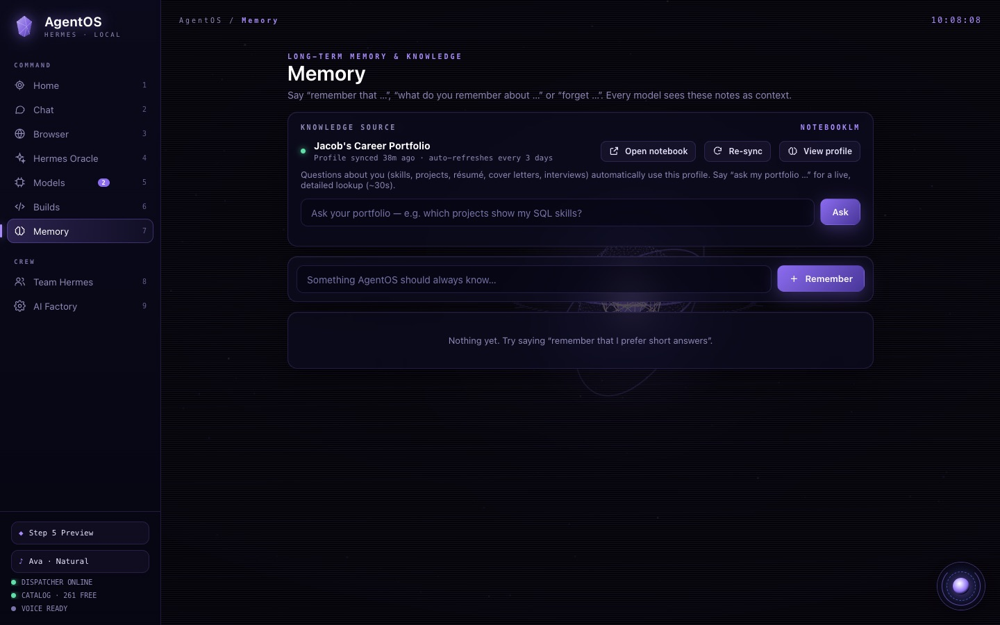
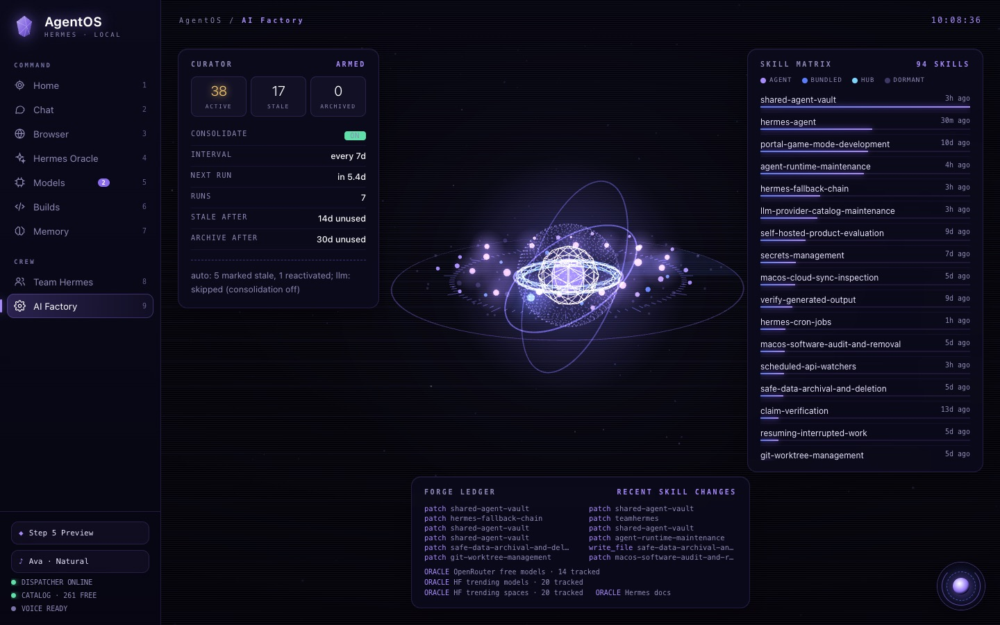
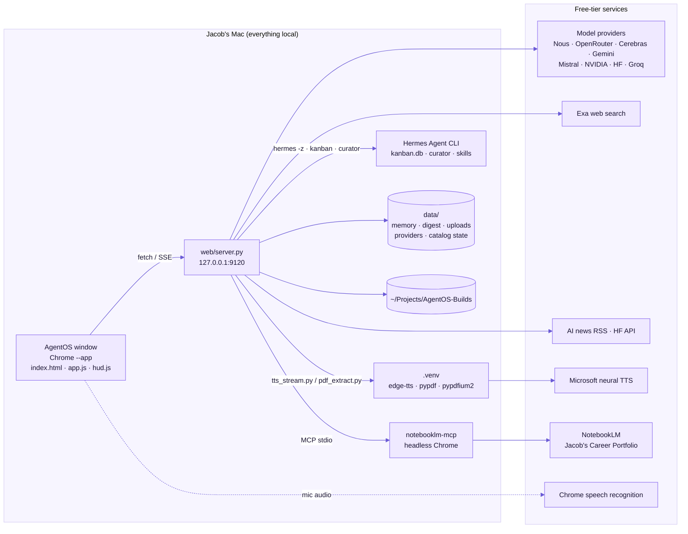

# AgentOS

**A local, voice-first operating system for a [Hermes Agent](https://hermes-agent.nousresearch.com) crew.** It puts Team Hermes and the AI Factory under one roof, behind a JARVIS-style voice home screen. Around that sit a live catalog of free models, a web browser, the Hermes Oracle AI-news feed, voice-built apps, long-term memory, NotebookLM portfolio grounding and drag-and-drop file understanding.

Runs only on `127.0.0.1:9120`. Python standard library + PyYAML on the server, vanilla JS + three.js r128 (vendored) in the browser. Free-tier models throughout.



## What it does

| Page | Highlights |
|---|---|
| **Home** | Voice orb that reacts to your voice and hers. Talk with **Space** or the mic, or say **"Hey AgentOS"** (wake word, off by default). Hands-free mode keeps the conversation going. Natural female neural voice (Ava by default). Modes: **Auto** (searches the web only when needed), **Web**, **Agent** (full Hermes tool loop). |
| **Chat** | Multi-session chat with any free model, auto web grounding, file attachments, spoken replies. |
| **Browser** | Exa web search plus a clean server-side reader view, with a page assistant that summarizes or answers questions about the open page. |
| **Hermes Oracle** | Live AI news from 9 feeds, Hugging Face trending and newly free models. *Consult the Oracle* writes a briefing; *Hear the brief* reads it aloud; *Draft this* turns a story into a post. |
| **Models** | Live free-tier catalog from Nous Portal, OpenRouter, Hugging Face, Cerebras, Gemini, Mistral, NVIDIA and Groq, plus any OpenAI-compatible provider you add. One-click test, NEW flags, auto-refresh. |
| **Builds** | "Build me a snake game." A model writes one self-contained app, saves it to `~/Projects/AgentOS-Builds/` and runs it in a sandbox. |
| **Memory** | "Remember that…", "What do you remember about…?", "Forget…", plus your **NotebookLM "Jacob's Career Portfolio"** as a knowledge source. |
| **Team Hermes** | 3D crew constellation, Kanban board and catalog-routed dispatch to the six Hermes bots. |
| **AI Factory** | Curator state, skill-matrix galaxy and forge ledger: the crew's self-improvement loop. |

**Across every page:**
- **Ghost text:** gray inline suggestions in every input. Tab accepts the whole suggestion, → accepts one word.
- **Files:** drag and drop anywhere, paste with ⌘V, or use 📎.
- **Floating reactor:** a corner orb you can talk to from any page.
- **Never stuck on a busy model:** if the chosen model is down, another free model takes over.

| | | |
|---|---|---|
|  |  |  |
|  |  |  |

## How it fits together



## Quick start

Open **AgentOS** from `/Applications`, Launchpad or Spotlight. It starts the server if needed and opens the app window.

```bash
agentos            # start the server and open the app window
agentos --stop     # stop the server (and its headless NotebookLM browser)
agentos --classic  # open the stock Hermes dashboard on :9119
agentos "task"     # dispatch a task to the crew from the terminal
```

Keys come from `~/.hermes/.env` (`NOUS_API_KEY`, `OPENROUTER_API_KEY`, `CEREBRAS_API_KEY`, `GOOGLE_API_KEY`, `MISTRAL_API_KEY`, `NVIDIA_API_KEY`, `HF_TOKEN`, `GROQ_API_KEY`, `EXA_AI_API_KEY`). First-time setup, rebuilding the app and troubleshooting are covered in [docs/OPERATIONS.md](docs/OPERATIONS.md).

## Documentation

| Guide | Covers |
|---|---|
| [**Diagram atlas**](docs/DIAGRAMS.md) | Start here: the whole system on one page and an index of every diagram |
| [Architecture](docs/ARCHITECTURE.md) | Components, runtime topology, startup, front end, 3D scene, API map, background jobs, storage and caching |
| [Voice](docs/VOICE.md) | Voice stack, orb states, intents, conversation turn, speech queue, neural voice pipeline |
| [Models & routing](docs/MODELS.md) | Key resolution, catalog refresh, free or paid, provider management, routing, fallback chains, ghost text |
| [Knowledge](docs/KNOWLEDGE.md) | Memory, NotebookLM bridge, file attachments, Oracle pipeline, search, reader, briefings |
| [Crew](docs/CREW.md) | Roster, task routing, dispatch shapes, Kanban board, AI Factory, Builds lifecycle and sandbox |
| [Security & privacy](docs/SECURITY.md) | Trust boundaries, what leaves the machine, request guards, reader guard, key flow |
| [Operations](docs/OPERATIONS.md) | Commands, setup, logs, troubleshooting flow, app build |
| [Changelog](CHANGELOG.md) | What changed and when |

## Repository layout

```
AgentOS.applescript     launcher compiled into /Applications/AgentOS.app
assets/                 app icon (svg + icns)
bin/agentos             start/stop/open; passes tasks to agentos-dispatch
bin/agentos-dispatch    routes a task through catalog.yaml into a Hermes Kanban graph
bin/build-app.sh        (re)builds /Applications/AgentOS.app
catalog.yaml            the six crew bots, roles and routing triggers
route.py                deterministic task → bots/shape router
web/server.py           HTTP + SSE server, all integrations
web/index.html · app.js · app.css   the UI
web/hud.js              three.js scene (voice orb, crew constellation, skill galaxy)
web/tts_stream.py       neural speech streamer (runs in .venv)
web/pdf_extract.py      PDF text + page rendering (runs in .venv)
docs/                   guides, diagram atlas, screenshots
data/                   local state — gitignored (keys, memory, uploads)
```
