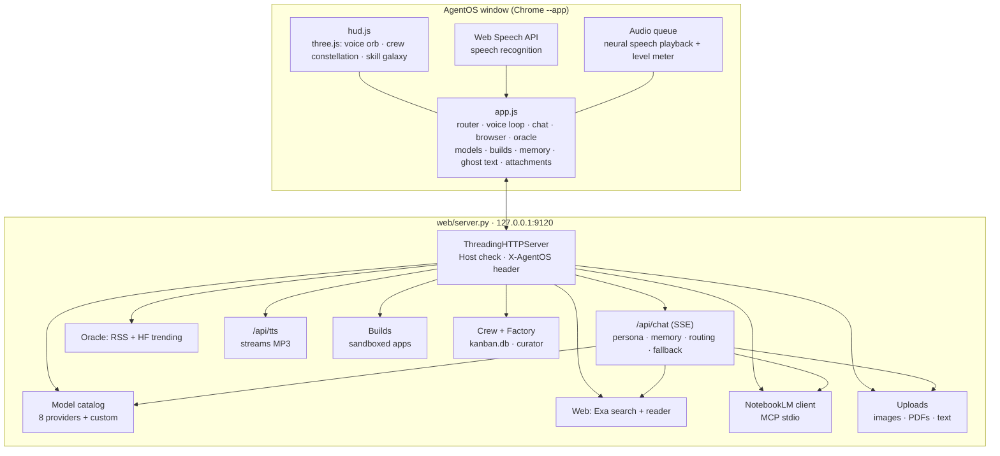
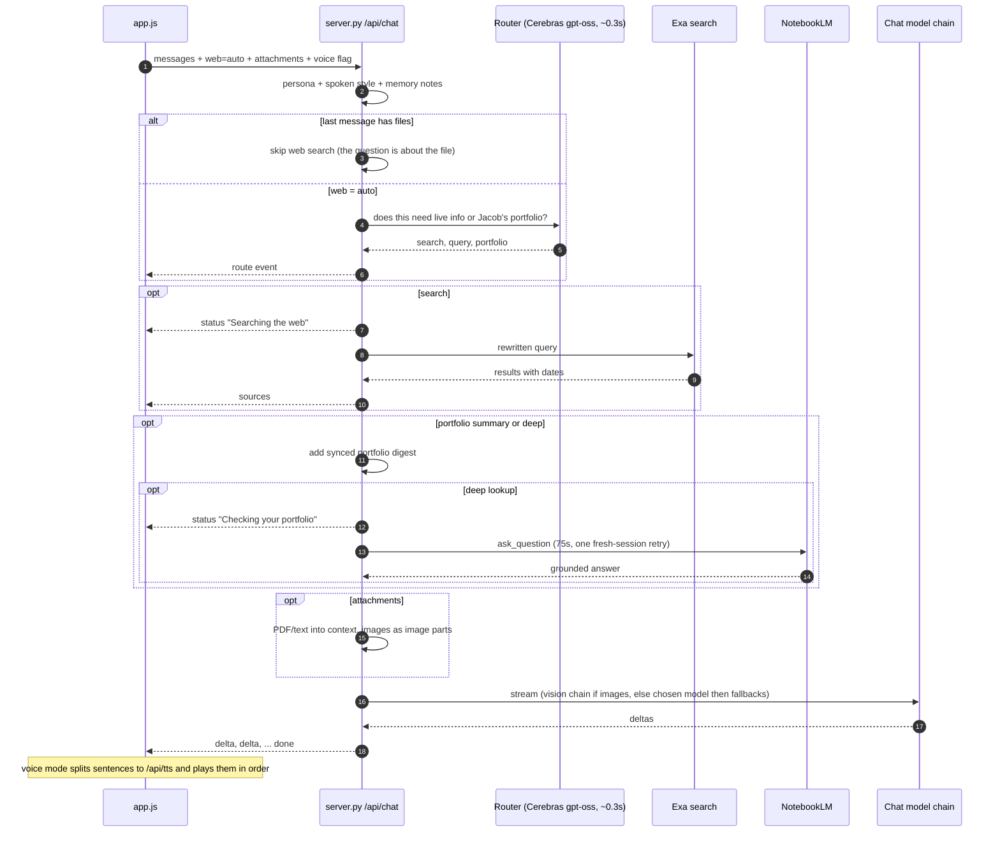

# Architecture

AgentOS has three parts:
- **`web/server.py`:** one Python process (standard library + PyYAML) bound to `127.0.0.1:9120`.
- **The UI:** a single-page app (`index.html`, `app.js`, `app.css`, `hud.js`) opened in a Chrome `--app` window.
- **Helpers:** small scripts run in AgentOS's own `.venv` for speech and PDFs, plus `notebooklm-mcp` for NotebookLM.

## Components

## Life of a chat request

Every spoken or typed message goes through `POST /api/chat`. The reply streams back as Server-Sent Events. Each step only happens when it's needed:

**The chain rules:**
- If the chosen model fails *before saying anything* (busy, 429, 5xx), the next model in the chain answers.
- If a model fails mid-reply, the error is shown. AgentOS never splices two models into one answer.
- Hermes Agent mode skips all of this and runs `hermes -z` with the conversation as context.

## API reference

**All routes:** requests must target `127.0.0.1` or `localhost` (DNS-rebinding guard).

**POST routes:** also require the header `X-AgentOS: 1`. A custom header forces a CORS preflight, which the server never grants, so other websites can't call these routes.

| Method | Path | Purpose |
|---|---|---|
| GET | `/api/state` | Crew, Kanban cards, curator, skills, Oracle watchers, catalog events (polled every 3s) |
| GET | `/api/models[?refresh=1]` | Live model catalog + provider status |
| POST | `/api/models/test` | Ping one model; result cached in `catalog_state.json` |
| POST | `/api/providers` · `/api/providers/delete` | Add/replace or remove a custom provider (or a pasted key for a built-in) |
| POST | `/api/chat` | **SSE**: `route` · `status` · `sources` · `thinking` · `model` · `delta` · `done` · `error` |
| POST | `/api/suggest` | Ghost-text completion / next-message prediction |
| GET | `/api/search?q=` | Exa web search |
| GET | `/api/read?url=` | Fetch a page and return a readable version (private addresses blocked) |
| GET | `/api/news[?refresh=1]` | Oracle: 9 RSS feeds + Hugging Face trending |
| GET | `/api/briefing` | Facts for the daily/weekly briefing |
| GET/POST | `/api/memory` · `/api/memory/delete` | Long-term memory notes |
| GET | `/api/portfolio` | NotebookLM status + synced digest |
| POST | `/api/portfolio/ask` · `/api/portfolio/refresh` | Live NotebookLM question / re-sync the digest |
| POST | `/api/upload` | Raw-body upload (`X-Filename` header), 25 MB max |
| GET | `/api/upload/{id}/thumb` | Thumbnail for an image or rendered PDF page |
| GET | `/api/voices` · `/api/tts?text=&voice=&rate=` | Voice list · streamed MP3 speech |
| GET | `/api/builds` · `/builds/{slug}/index.html` | Build list · built app (served with a CSP sandbox) |
| POST | `/api/build` · `/api/builds/delete` | **SSE** build · move a build to `.trash` |
| POST | `/api/open` | Open an http(s) URL in the real Chrome |
| POST | `/api/dispatch` | Run `bin/agentos-dispatch` (optionally `--dry-run`) |

## Background jobs

| Job | Cadence | What it does |
|---|---|---|
| Catalog loop | checks every 10 min, refreshes if older than 30 min | Lists models from every provider, flags newly seen free models (NEW for 7 days), emits catalog events the UI turns into toasts |
| News loop | every 15 min | Re-pulls the 9 feeds + HF trending |
| Portfolio loop | on launch, then every 5 min | Warm-up question to NotebookLM. Re-syncs the digest if older than 3 days, closes the headless browser after 30 idle minutes, prunes uploads older than 30 days |
| UI poll | every 3 s | `/api/state` drives crew/Kanban/factory panels and new-model toasts |

## Local data

Everything stateful lives in `~/.hermes/agentos/data/`. The folder is gitignored.

| File | Contents | Mode |
|---|---|---|
| `providers.json` | Custom providers and pasted API keys | 600 |
| `memory.json` | Memory notes | 600 |
| `portfolio_digest.json` | Synced NotebookLM profile | 600 |
| `catalog_state.json` | When each model was first seen + test results | 644 |
| `notebooklm.log` | The NotebookLM bridge's own log | 644 |
| `uploads/{id}/` | Original file, normalized image or rendered pages, extracted text, `meta.json` | 644 |

Built apps live in `~/Projects/AgentOS-Builds/{slug}/` (`index.html` + `agentos.json`). Removed builds go to `.trash/`.
