# Crew: Team Hermes, AI Factory and Builds

## Team Hermes

Six Hermes bot profiles make up the crew. Their roles and routing triggers live in `catalog.yaml`, the single source of truth:

| Bot | Role | Notes |
|---|---|---|
| orchestrator | Coordinate multi-bot tasks, decompose, synthesize | Joins when 2+ specialists are involved |
| research | Find facts from live sources, cite every claim | |
| writer | Draft finished content from briefs | Paired with auditor |
| developer | Build and fix tools, scripts, automation, config | Paired with auditor |
| auditor | Verify claims, code and briefs before delivery | |
| librarian | Vault caretaker | **Only when named.** Never auto-summoned |

### Roster

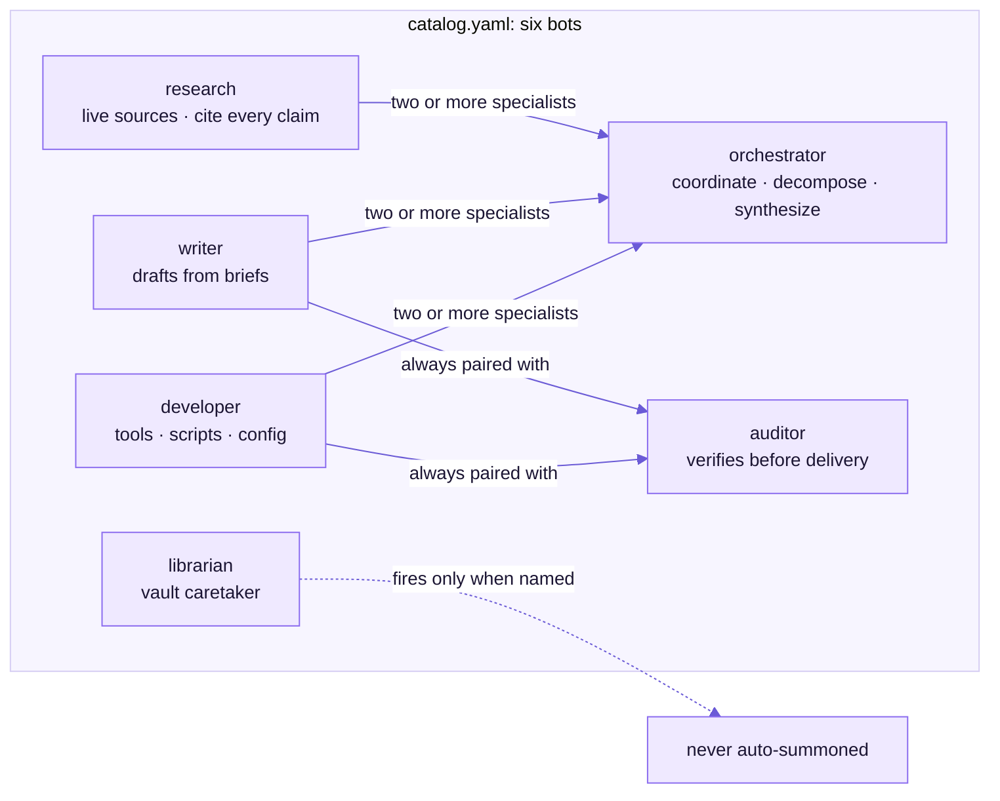

### How a task is routed

`route.py` is deterministic: the same task and catalog always give the same plan. It reads triggers from `catalog.yaml` and matches them at word starts, so "audit" also hits "auditing".

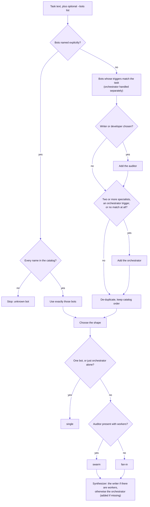

Run for real on the router, these tasks produce:

| Task | Bots | Shape | Synthesizer |
|---|---|---|---|
| "research the latest models" | research | single | none |
| "build a script" | orchestrator, developer, auditor | swarm | orchestrator |
| "research free models and write a summary" | orchestrator, research, writer, auditor | swarm | writer |
| "clean up the vault" | librarian | single | none |
| "tell me a joke" | orchestrator | single | orchestrator |

### Dispatch flow

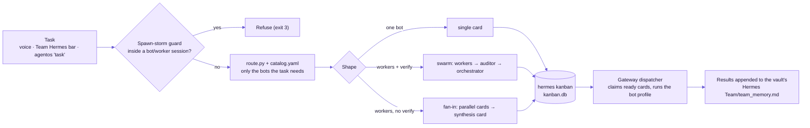

### The three shapes

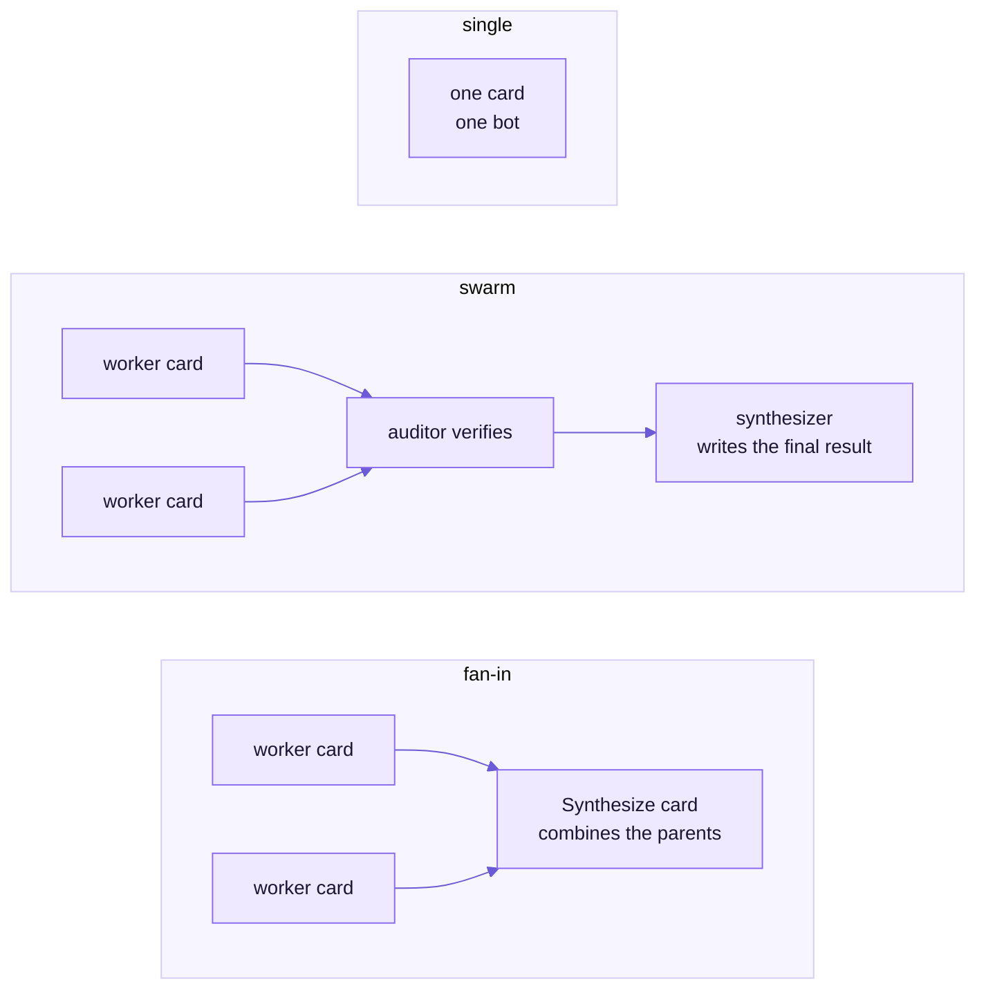

### From task to result

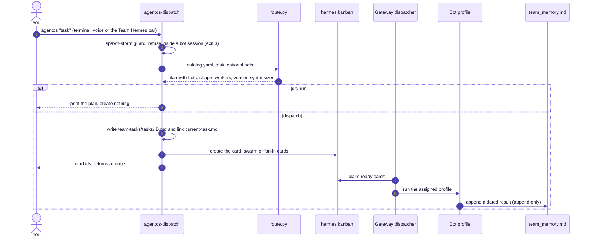

**The five rules** (born from a real spawn-storm incident):
1. Only summon the bots the task needs.
2. Never auto-summon the librarian.
3. Include the orchestrator for 2+ specialists or synthesis.
4. Return control immediately.
5. Never dispatch from inside a bot session.

**On the Team Hermes page:**
- **3D constellation:** the bots, with the orchestrator on top. Running bots glow gold and send data packets along their links; blocked bots turn red.
- **Kanban panel:** live cards from `kanban.db`.
- **Command bar:** **Preview** shows the routing plan (dry run); **Dispatch** creates the cards.

### Reading the board

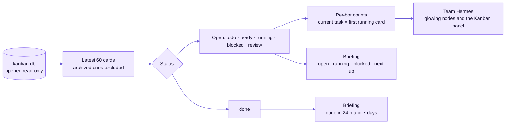

## AI Factory

The Hermes **curator** is the crew's self-improvement loop:
- **Creates:** `/learn` turns a URL, a folder or the current chat into a skill.
- **Maintains:** the curator marks stale skills and archives unused ones. It never deletes, and with consolidation on it merges overlapping skills.

The AI Factory page shows:
- **Curator panel:** active, stale and archived counts, the consolidation switch, interval, next run, and the last run's report.
- **Skill matrix:** every skill, ranked by activity, and drawn as a galaxy in 3D. Agent-made skills are lavender, bundled ones blue, hub skills cyan, and dormant ones dim.
- **Forge ledger:** recent skill changes, plus the Oracle watchers' status.

### Where the data comes from

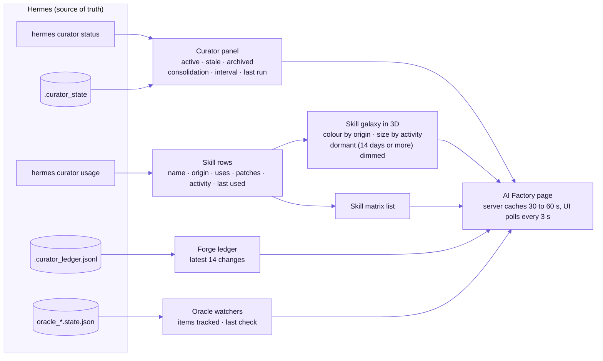

### Skill lifecycle

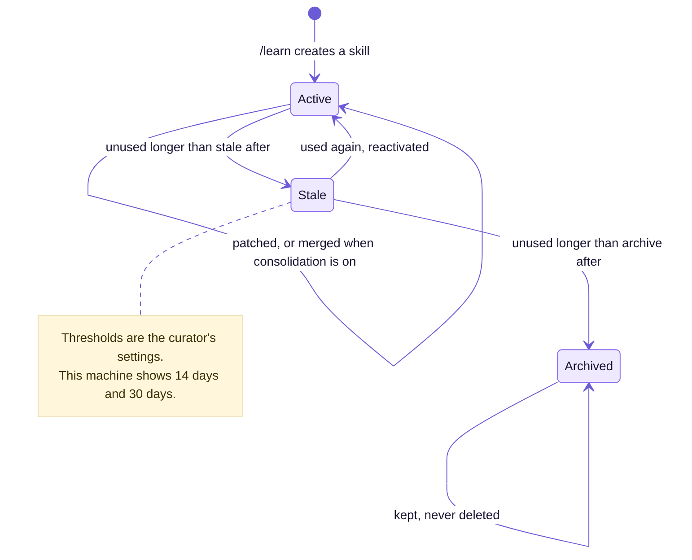

## Builds

"Build me a snake game" (by voice, or on the Builds page):

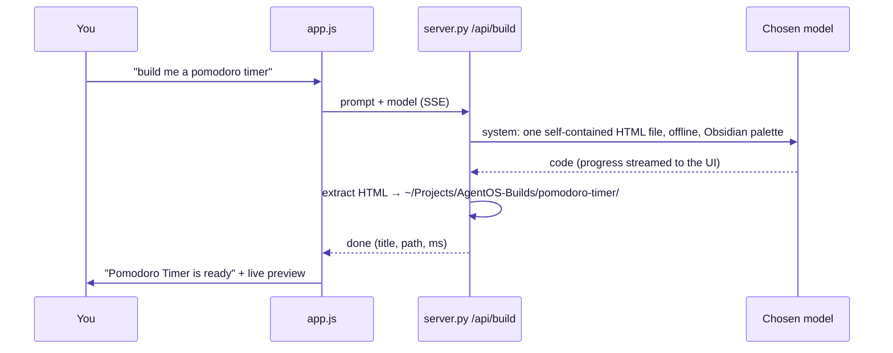

- **Sandboxed:** built apps run in a sandboxed `srcdoc` iframe, and are served with `Content-Security-Policy: sandbox`, so even *Open in window* gives them an opaque origin. Generated code can never call the AgentOS API.
- **Recoverable removal:** *Remove* moves a build to `AgentOS-Builds/.trash/`.

### Build lifecycle

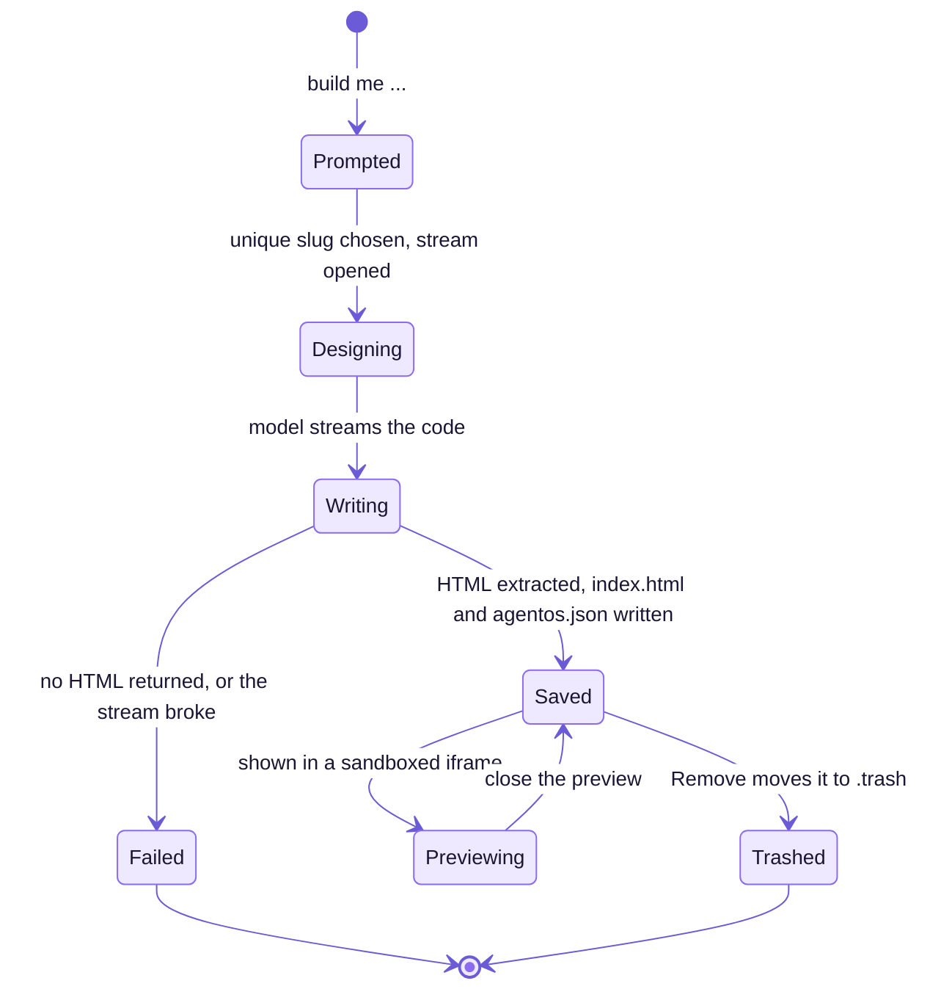

### Sandbox boundary

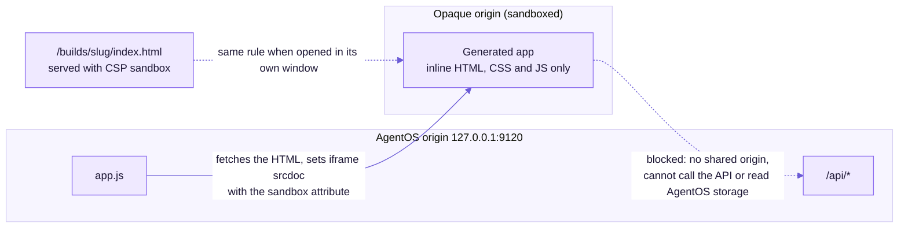
