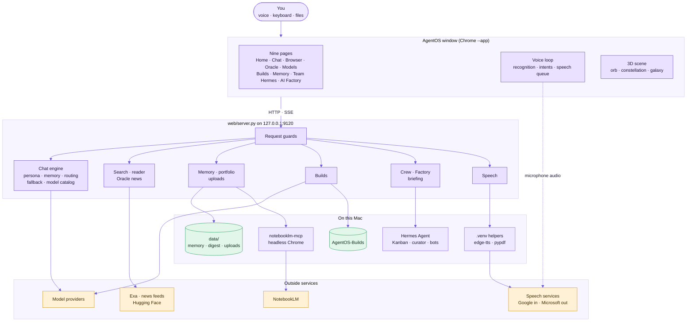

# Diagram atlas

AgentOS is documented diagram-first. This page shows the **whole system on one page**, then indexes **56 diagrams** so every part has its own: what it is, how it moves, and where its data lives.

How to read them: boxes are components, cylinders are stored data, solid arrows are calls or data flow, dotted arrows are optional or blocked paths. In the system map below, **purple** is AgentOS code, **green** is data on disk and **amber** is a service outside this Mac.

## The whole system

## Follow a request

Six everyday requests, and the parts each one touches.

| You say or do | Path through the system | Read more |
|---|---|---|
| "What's the latest on …?" | Voice loop, intents (no match), `/api/chat`, router decides to search, Exa, model stream, speech queue, `/api/tts` | [Voice](VOICE.md#one-conversational-turn) · [Chat flow](ARCHITECTURE.md#life-of-a-chat-request) · [Search](KNOWLEDGE.md#search-reader-and-page-assistant) |
| "Build me a snake game" | Intent, `/api/build`, model writes one HTML file, saved to `AgentOS-Builds`, previewed in a sandbox | [Build lifecycle](CREW.md#build-lifecycle) · [Sandbox](CREW.md#sandbox-boundary) |
| "Tell the crew to research …" | Intent, `/api/dispatch`, `route.py`, Kanban cards, gateway dispatcher, bot profiles, `team_memory.md` | [Routing](CREW.md#how-a-task-is-routed) · [Task to result](CREW.md#from-task-to-result) |
| "Ask my portfolio …" | Intent, NotebookLM bridge (one warm browser), grounded answer with a notebook link | [Bridge](KNOWLEDGE.md#bridge-lifecycle) · [Portfolio](KNOWLEDGE.md#notebooklm-portfolio) |
| Drop a screenshot | `/api/upload`, normalise with `sips`, attach to the message, vision chain | [Uploads](KNOWLEDGE.md#files-drag-drop-paste) · [Fallback](MODELS.md#fallback-logic) |
| "Good morning" | `/api/briefing` gathers board, curator, headlines, new models and memories, model writes the script | [Briefings](KNOWLEDGE.md#briefings) |

## Index of every diagram

### System

| Diagram | Type | Where |
|---|---|---|
| System overview | Flowchart | [README](../README.md#how-it-fits-together) |
| Components | Flowchart | [Architecture](ARCHITECTURE.md#components) |
| Runtime topology (processes and threads) | Flowchart | [Architecture](ARCHITECTURE.md#runtime-topology) |
| Startup sequence | Sequence | [Architecture](ARCHITECTURE.md#startup-sequence) |
| Life of a chat request | Sequence | [Architecture](ARCHITECTURE.md#life-of-a-chat-request) |
| Front-end structure | Flowchart | [Architecture](ARCHITECTURE.md#front-end) |
| The 3D scene | Flowchart | [Architecture](ARCHITECTURE.md#the-3d-scene) |
| API map | Flowchart | [Architecture](ARCHITECTURE.md#api-map) |
| Job schedule | Flowchart | [Architecture](ARCHITECTURE.md#job-schedule) |
| Storage map | Flowchart | [Architecture](ARCHITECTURE.md#storage-map) |
| Cache behaviour | Flowchart | [Architecture](ARCHITECTURE.md#caching) |

### Voice

| Diagram | Type | Where |
|---|---|---|
| Voice stack | Flowchart | [Voice](VOICE.md#the-voice-stack) |
| Orb states | State | [Voice](VOICE.md#states) |
| From your voice to her voice | Sequence | [Voice](VOICE.md#from-your-voice-to-her-voice) |
| Intent router | Flowchart | [Voice](VOICE.md#how-she-understands-you) |
| One conversational turn | Flowchart | [Voice](VOICE.md#one-conversational-turn) |
| Speech queue | Flowchart | [Voice](VOICE.md#how-she-speaks) |
| `/api/tts` pipeline | Flowchart | [Voice](VOICE.md#how-she-speaks) |

### Models and routing

| Diagram | Type | Where |
|---|---|---|
| Key resolution | Flowchart | [Models](MODELS.md#key-resolution) |
| Catalog refresh pipeline | Flowchart | [Models](MODELS.md#refresh-pipeline) |
| Free or paid classification | Flowchart | [Models](MODELS.md#free-or-paid) |
| Provider management | Sequence | [Models](MODELS.md#provider-management) |
| Routing decision tree | Flowchart | [Models](MODELS.md#routing) |
| Fallback logic | Flowchart | [Models](MODELS.md#fallback-logic) |
| Ghost text | Flowchart | [Models](MODELS.md#ghost-text) |

### Knowledge

| Diagram | Type | Where |
|---|---|---|
| Memory flow | Flowchart | [Knowledge](KNOWLEDGE.md#how-memory-flows) |
| Portfolio digest and lookup | Flowchart | [Knowledge](KNOWLEDGE.md#notebooklm-portfolio) |
| NotebookLM bridge lifecycle | State | [Knowledge](KNOWLEDGE.md#bridge-lifecycle) |
| File attachments | Flowchart | [Knowledge](KNOWLEDGE.md#files-drag-drop-paste) |
| Oracle news pipeline | Flowchart | [Knowledge](KNOWLEDGE.md#oracle-pipeline) |
| Search and reader | Flowchart | [Knowledge](KNOWLEDGE.md#search-reader-and-page-assistant) |
| Page assistant | Sequence | [Knowledge](KNOWLEDGE.md#search-reader-and-page-assistant) |
| Briefings | Sequence | [Knowledge](KNOWLEDGE.md#briefings) |

### Crew, Factory and Builds

| Diagram | Type | Where |
|---|---|---|
| Roster and pairing rules | Flowchart | [Crew](CREW.md#roster) |
| Task routing (`route.py`) | Flowchart | [Crew](CREW.md#how-a-task-is-routed) |
| Dispatch flow | Flowchart | [Crew](CREW.md#dispatch-flow) |
| The three shapes | Flowchart | [Crew](CREW.md#the-three-shapes) |
| Task to result | Sequence | [Crew](CREW.md#from-task-to-result) |
| Reading the Kanban board | Flowchart | [Crew](CREW.md#reading-the-board) |
| AI Factory data sources | Flowchart | [Crew](CREW.md#where-the-data-comes-from) |
| Skill lifecycle | State | [Crew](CREW.md#skill-lifecycle) |
| Builds sequence | Sequence | [Crew](CREW.md#builds) |
| Build lifecycle | State | [Crew](CREW.md#build-lifecycle) |
| Sandbox boundary | Flowchart | [Crew](CREW.md#sandbox-boundary) |

### Security

| Diagram | Type | Where |
|---|---|---|
| What leaves the machine | Flowchart | [Security](SECURITY.md#what-leaves-the-machine) |
| Trust boundaries | Flowchart | [Security](SECURITY.md#trust-boundaries) |
| Request guards | Flowchart | [Security](SECURITY.md#request-guards) |
| Reader guard | Flowchart | [Security](SECURITY.md#reader-guard) |
| Key flow | Flowchart | [Security](SECURITY.md#key-flow) |

### Operations

| Diagram | Type | Where |
|---|---|---|
| Launch path | Flowchart | [Operations](OPERATIONS.md#run) |
| Commands | Flowchart | [Operations](OPERATIONS.md#commands) |
| Setup at a glance | Flowchart | [Operations](OPERATIONS.md#setup-at-a-glance) |
| Triage flow | Flowchart | [Operations](OPERATIONS.md#triage-flow) |
| Building the app | Flowchart | [Operations](OPERATIONS.md#building-the-app) |

All diagrams are [Mermaid](https://mermaid.js.org), so GitHub renders them in place and they stay editable as plain text.
