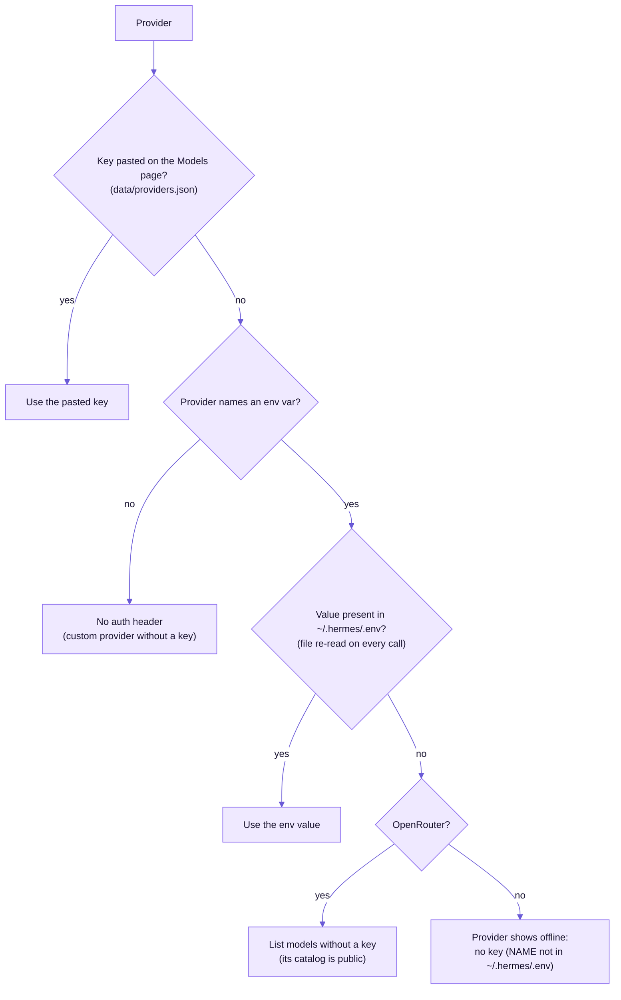
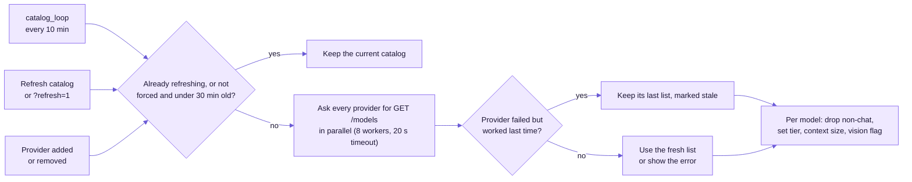
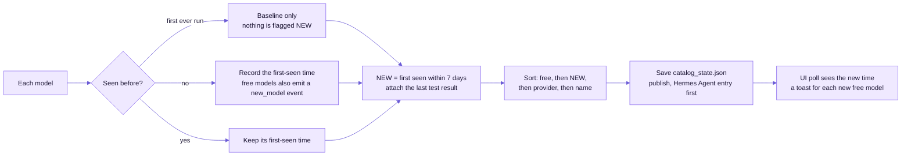
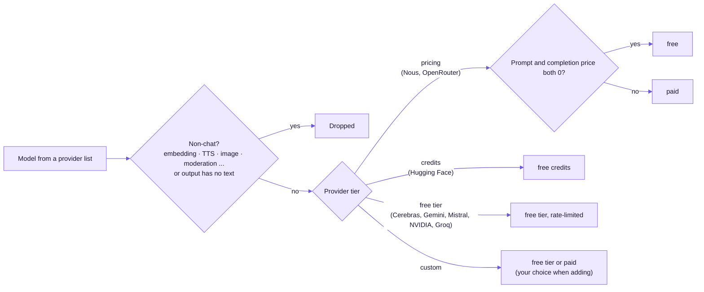
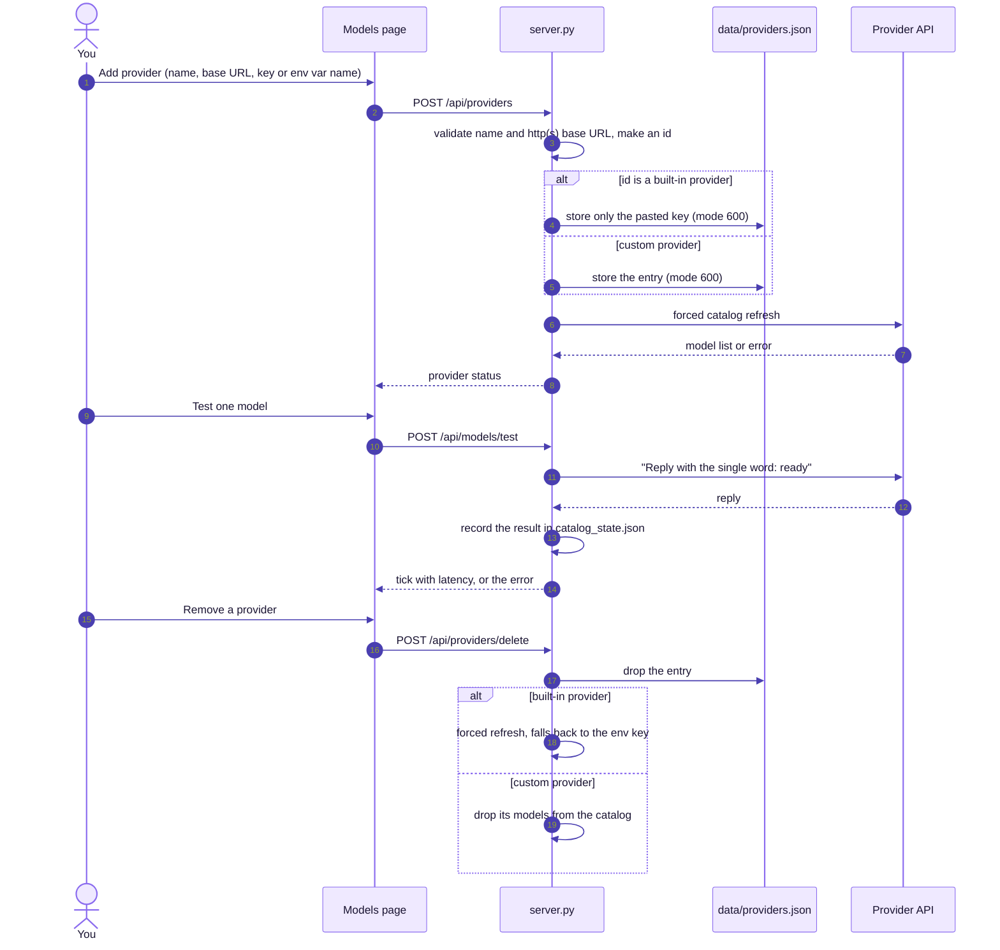
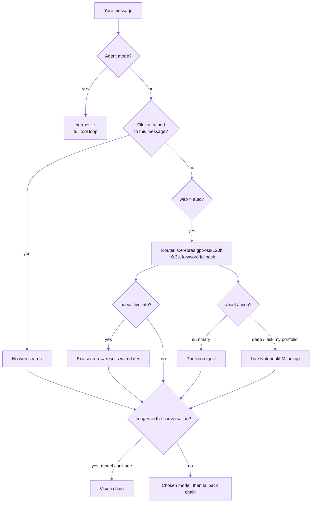
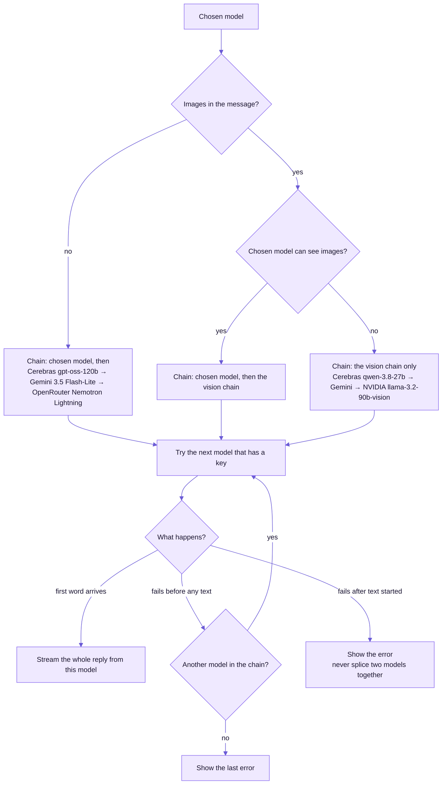
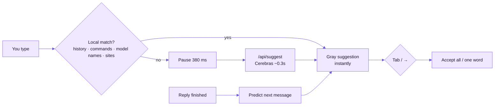

# Models & routing

## Live catalog

The server lists models from every provider whose key is in `~/.hermes/.env`, plus any custom OpenAI-compatible provider you add on the Models page. It filters out non-chat models (embeddings, TTS, image generation…) and marks each model's tier:

| Provider | Key | How "free" is decided |
|---|---|---|
| Nous Portal | `NOUS_API_KEY` | price = 0 (`:free` models). Requests carry `tags: [product=agentos, user=…]` |
| OpenRouter | `OPENROUTER_API_KEY` | price = 0 |
| Hugging Face | `HF_TOKEN` | monthly free credits |
| Cerebras · Google Gemini · Mistral · NVIDIA NIM · Groq | provider key | free tier (rate-limited) |
| Custom | pasted key or env var | you choose |

**Refresh:** checked every 10 minutes and refreshed when older than 30, or on demand with *Refresh catalog*. A free model never seen before gets a **NEW** flag for 7 days, a sidebar badge, a toast and an entry in the Oracle's *New free models*.

**Test:** sends a one-word ping and records ✓ with its latency or ✗ with the error. The model picker (⌘K) lists tested-and-working models first.

### Key resolution

A pasted key beats the environment, so you can override one provider without touching `~/.hermes/.env`.

### Refresh pipeline

Then each model is stamped and the catalog is published:

### Free or paid?

## Provider management

## Routing

| Chain | Order (benchmarked 2026-10-14) |
|---|---|
| **Vision** (screenshots, images, scanned PDFs) | Cerebras `qwen-3.8-27b` (0.5s) → Gemini `gemini-3.5-flash-lite` (3.2s) → NVIDIA `llama-3.2-90b-vision-instruct` (3.9s). All three read a test screenshot correctly |
| **Fallback** (chosen model busy/down before its first word) | Cerebras `gpt-oss-120b` → Gemini `gemini-3.5-flash-lite` → OpenRouter `nvidia/nemotron-3.5-lightning:free` |
| **Router / ghost text** | Cerebras `gpt-oss-120b` (low reasoning, ~0.3s) → Nous `upstage/solar-mini4:free` (~1s) → Mistral `ministral-8b-latest` |
| **Builds** | the chosen model (Step 5 when the Hermes agent is selected). Cerebras `gpt-oss-120b` builds a small app in under 2s |

### Fallback logic

The default chat model is **StepFun Step 5 Preview** on Nous Portal. It's strong, with the best briefings, but slow on long prompts (about 50s for an Oracle briefing) and occasionally "at capacity". The fallback chain covers it when it's busy.

## Persona

Every request gets:
- AgentOS's persona: warm, FRIDAY-to-JARVIS, aware that it has live web search.
- Today's date.
- Accurate facts about Hermes, such as `/learn` for skills.
- Your memory notes.
- Spoken replies add a conversational style guide: contractions, short sentences, no lists or URLs, under about 70 words.

## Ghost text

Ghost text runs on every input: the Home voice bar, the Chat composer, the Browser address bar, the page assistant, Team Hermes dispatch, Builds, Memory and the portfolio question box.
