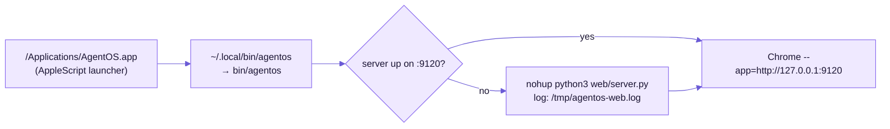
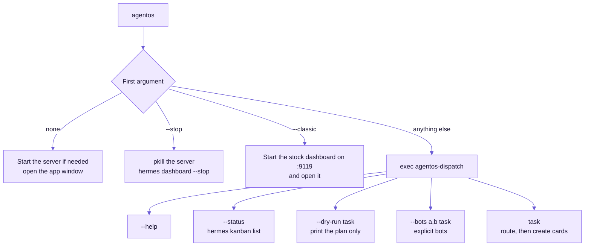
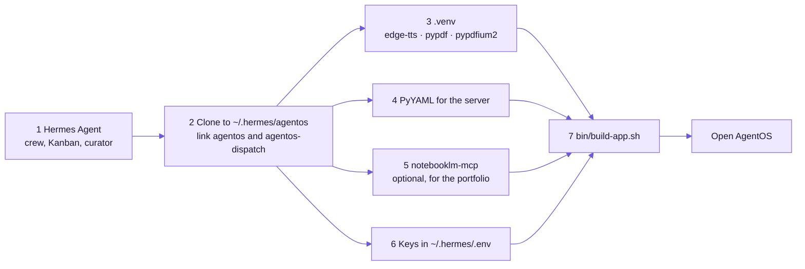
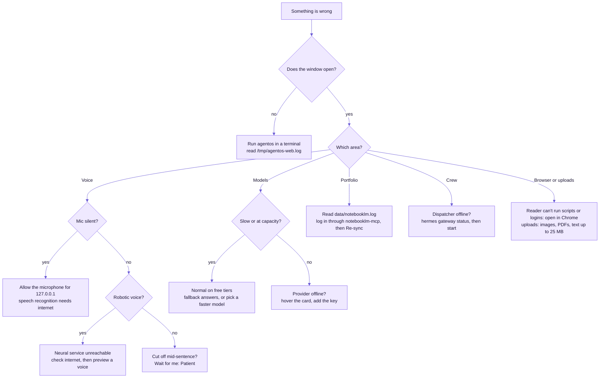
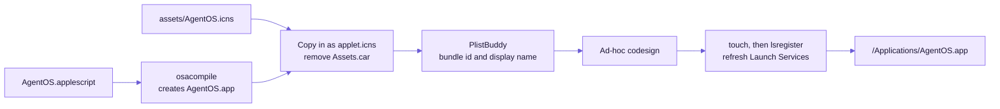

# Operations

## Run

| Action | How |
|---|---|
| Start + open | Open **AgentOS** from `/Applications`, Launchpad or Spotlight, or run `agentos` |
| Stop | `agentos --stop`. This also closes AgentOS's headless NotebookLM browser |
| Stock Hermes dashboard | `agentos --classic` (port 9119) |
| Dispatch from the terminal | `agentos "research the best free coding models"` · `agentos --dry-run "…"` · `agentos --status` |
| Pick up code changes | `agentos --stop && agentos`, then ⌘R in the window |



### Commands



## First-time setup (new machine)

1. Install and configure Hermes Agent. The crew profiles, Kanban and curator come from Hermes.
2. Clone this repo to `~/.hermes/agentos`, then link the launchers:
   ```bash
   ln -sf ~/.hermes/agentos/bin/agentos ~/.local/bin/agentos && ln -sf ~/.hermes/agentos/bin/agentos-dispatch ~/.local/bin/agentos-dispatch
   ```
3. Create AgentOS's helper environment (neural voice + PDFs):
   ```bash
   cd ~/.hermes/agentos && uv venv .venv && VIRTUAL_ENV=.venv uv pip install edge-tts pypdf pypdfium2 pillow
   ```
4. The server itself needs PyYAML: `python3 -m pip install pyyaml`.
5. Optional, for portfolio grounding: install `notebooklm-mcp` at `~/.npm-global/bin/notebooklm-mcp` and log in once through its own setup.
6. Put your keys in `~/.hermes/.env` (see the README).
7. Build the launcher: `bin/build-app.sh`

### Setup at a glance



## Logs

| Log | Path |
|---|---|
| Server | `/tmp/agentos-web.log` |
| NotebookLM bridge | `~/.hermes/agentos/data/notebooklm.log` |
| Crew activity | `hermes kanban watch` · vault `Hermes Team/team_memory.md` |

## Troubleshooting

| Symptom | Fix |
|---|---|
| No AgentOS in Applications | Run `~/.hermes/agentos/bin/build-app.sh` |
| Mic does nothing / "Microphone blocked" | Click the site-settings icon in the AgentOS window and allow the microphone for 127.0.0.1. Speech recognition also needs internet |
| She cuts you off mid-sentence | ♪ in the sidebar → **Wait for me** → Patient (4s) |
| Robotic voice | The neural voice service was unreachable, so AgentOS used the system voice. Check internet, then ♪ → preview a voice |
| "Model at capacity" / slow replies | Normal for free tiers. The fallback chain answers automatically. Or pick a faster model (⌘K), such as Cerebras `gpt-oss-120b` |
| Portfolio lookups time out | Check `data/notebooklm.log`. If it says you're logged out, log in again through `notebooklm-mcp`'s own setup (**not** from AgentOS). Re-sync from the Memory page |
| Catalog shows a provider offline | Hover the provider card for the error. "no key" means add it on the card or in `~/.hermes/.env` |
| Dispatcher offline | `hermes gateway status`, then `hermes gateway start` (or `hermes gateway run` in the foreground). Kanban cards wait until it runs |
| A page won't open in Browser | The reader can't run scripts or logins. Use ↗ to open it in Chrome |
| Upload refused | Only images, PDFs and text/code files up to 25 MB. Broken PDFs are rejected with the parser's error |

### Triage flow



## Rebuilding the app icon

`assets/agentos.svg` is the source. To regenerate `assets/AgentOS.icns`, render it to PNG with transparency, make an iconset with `sips`, and run `iconutil`. Then run `bin/build-app.sh`.

### Building the app


