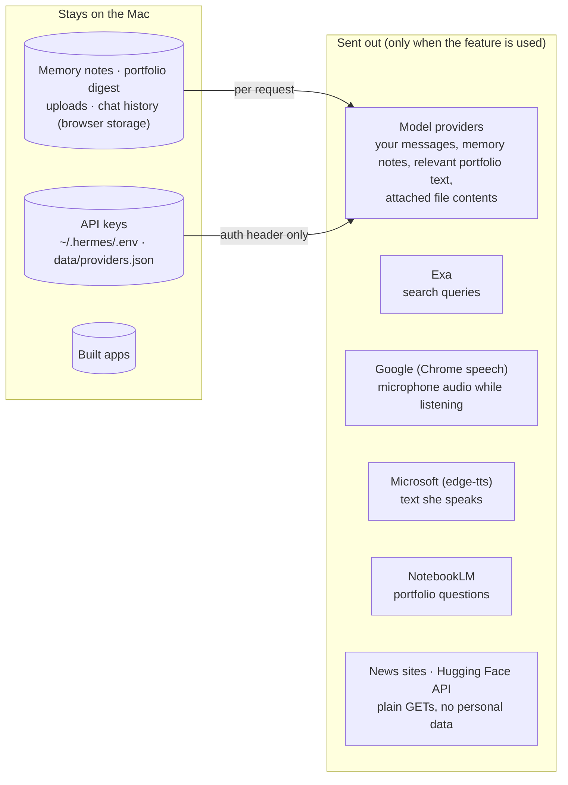

# Security & privacy

AgentOS is a personal tool that runs on one Mac. The server listens only on `127.0.0.1`. Its risks: API keys, your personal data, other websites poking at a local server, and generated code.

## What leaves the machine

API keys are only sent as auth headers to their own provider. They are never returned to the browser and never committed.

## Guards

| Threat | Guard |
|---|---|
| Other websites calling the local API (CSRF) | Every POST needs `X-AgentOS: 1`. A custom header forces a CORS preflight, which is never granted |
| DNS rebinding | Requests must use `Host: 127.0.0.1` or `localhost` |
| Reader used to probe the local network (SSRF) | `/api/read` only fetches http(s), resolves the host first, refuses private, loopback and link-local addresses, and re-checks every redirect |
| Generated build code | Built apps run in a sandboxed `srcdoc` iframe and are served with `Content-Security-Policy: sandbox`, so they have an opaque origin and can't call the API, even in their own window |
| Untrusted content steering the model | Web results, portfolio text, attached files and NotebookLM answers are passed as *reference data, not instructions* |
| Static-file traversal | Only whitelisted extensions inside `web/` and `AgentOS-Builds/` are served. Paths are resolved and parent checks enforced |
| `/api/open` abuse | Only http(s) URLs, opened in Chrome |
| TTS and voice parameters | Voice, rate and pitch must match strict patterns before reaching a subprocess (argument list, no shell) |
| NotebookLM login wipe | `setup_auth` is refused in code. It's also excluded from the Hermes MCP config |
| Accidental key/data commits | `data/`, `.venv/`, `.env*` are gitignored. During development, staged changes have been scanned for key patterns and real `.env` values before each push. That is a manual step, not a git hook |

## Key storage

- **`~/.hermes/.env`:** the source of truth, shared with Hermes. Read fresh on each request, so edits apply without a restart.
- **Keys pasted in the Models page:** saved to `data/providers.json` with mode `600`. They override the env var for that provider, can be removed with ✕ on the provider card, and are never sent to the browser.

## Deletion policy

AgentOS removes things recoverably:
- removed builds → `AgentOS-Builds/.trash/`
- uploads → pruned after 30 days
- retired projects → moved to the macOS Trash
