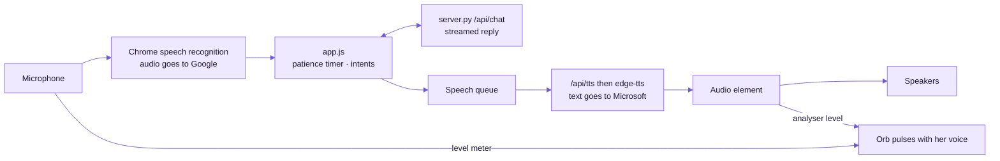
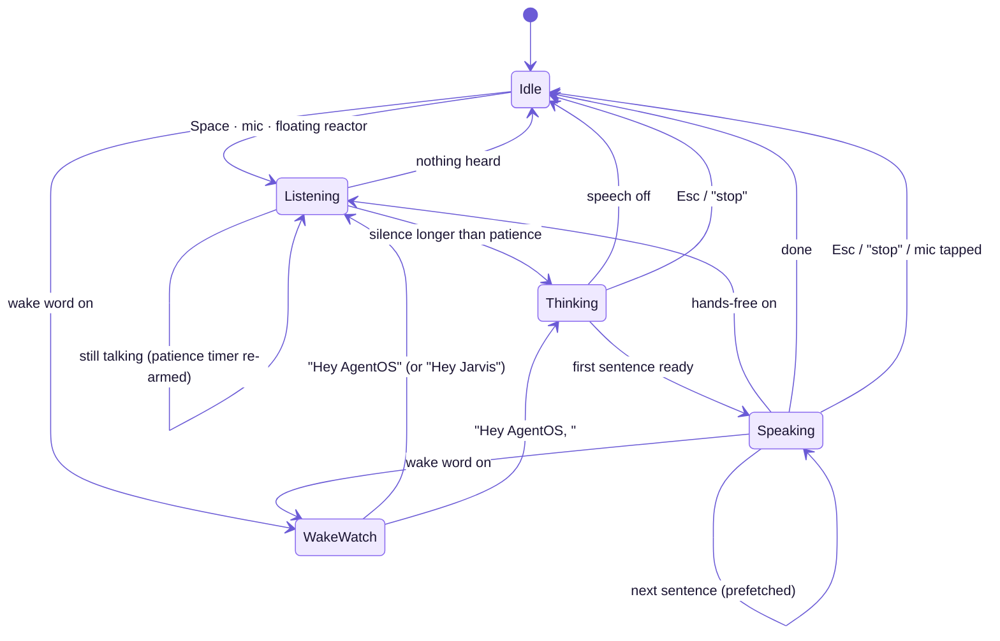
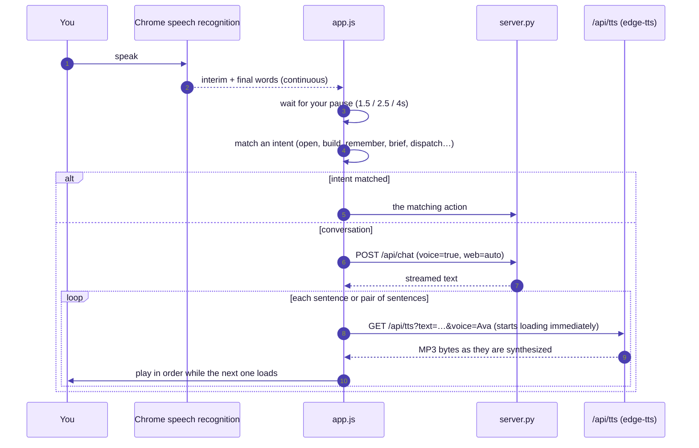
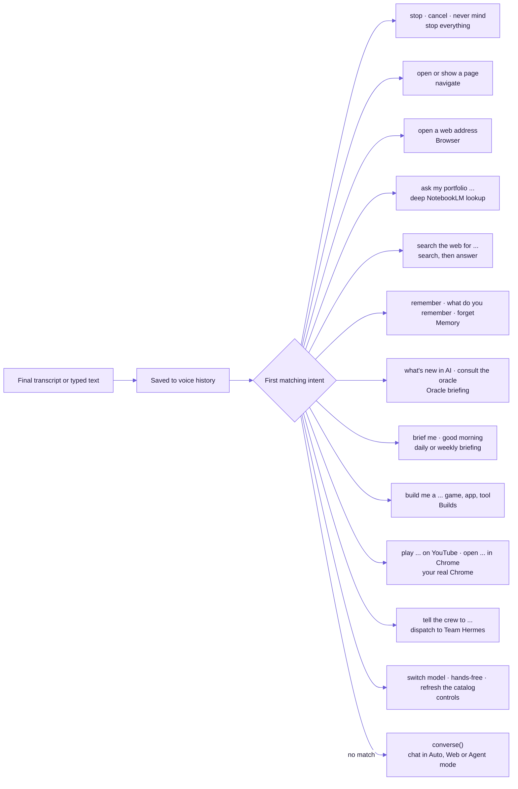
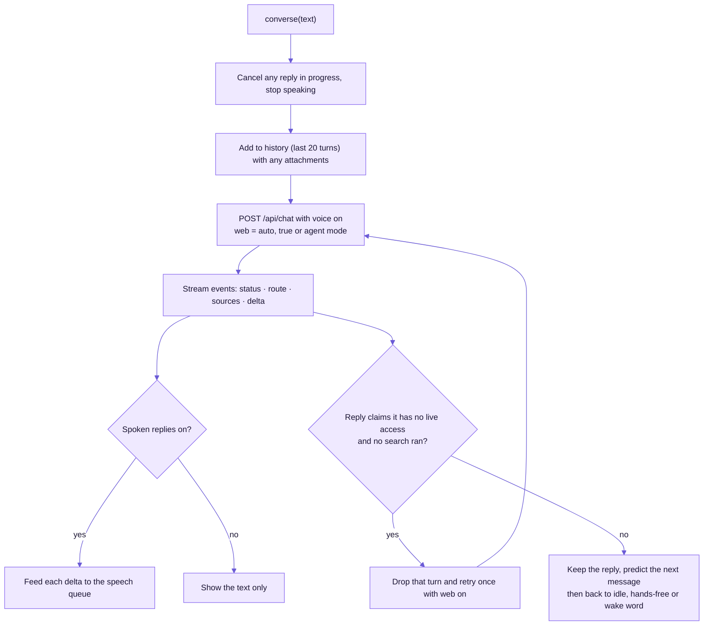
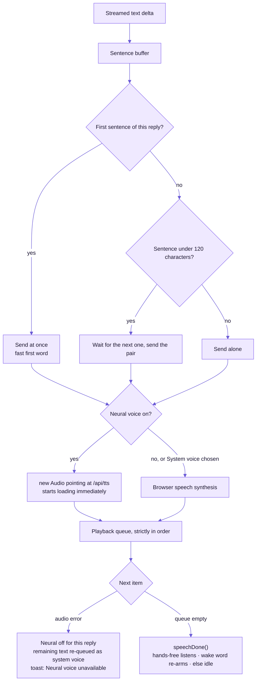
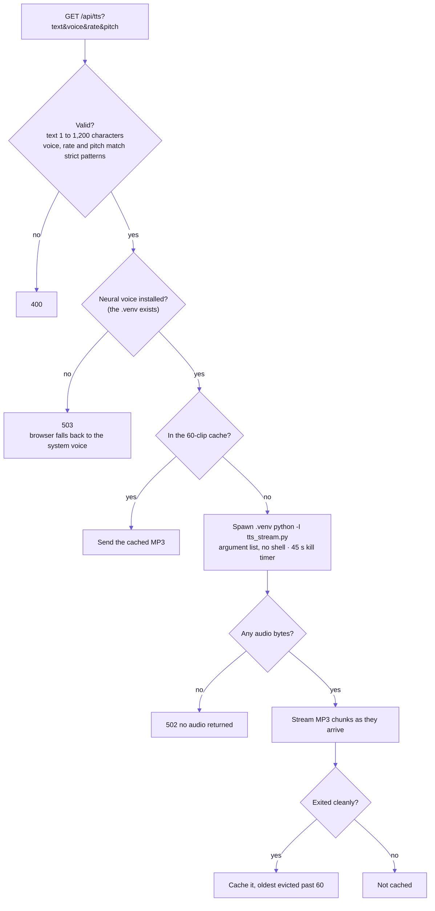

# Voice

Home is a voice interface. You speak through Chrome's speech recognition. She answers with a natural female neural voice (Microsoft, via `edge-tts`), streamed sentence by sentence, while the orb follows the real loudness of both voices.

## The voice stack

## States

The orb's color follows the state: **purple** idle, **blue** listening, **violet** thinking (spins faster), **lavender** speaking (pulses with her voice).

## From your voice to her voice

- **Speed:** the first sentence goes out on its own so she starts talking quickly (about 1.2s to first audio). Later sentences are paired for a more natural flow. Replays come from a 60-item cache.
- **Fallback:** if the neural voice can't be reached, the rest of the reply uses a female macOS system voice (Samantha, Karen, Moira…), never a male one.

## How she understands you

Every utterance, spoken or typed, is checked against a short list of intents in this order. The first match wins. Anything else is a normal conversation.

### One conversational turn

## How she speaks

On the server, `/api/tts` validates, checks the cache, then streams audio as it is synthesised.

## Settings (♪ in the sidebar)

| Setting | Options | Default |
|---|---|---|
| Voice | Ava, Emma, Jenny, Aria, Michelle (US) · Sonia, Libby (UK) · Natasha (AU) · Emily (IE) · System | Ava |
| Pace | Relaxed (−8%) · Natural · Brisk (+8%) | Natural |
| Wait for me | Quick 1.5s · Normal 2.5s · Patient 4s of silence ends your turn | Normal |

**Voice bar buttons:** 🎤 talk · 📎 attach · **Auto / Web / Agent** · ☀ briefing · 👂 wake word · ∞ hands-free · 🔊 spoken replies.

## Things you can say

| Say | What happens |
|---|---|
| "Open the oracle / models / team hermes / builds…" | Navigates |
| "Search the web for …" | Answers from live results; the results also open in Browser |
| "What's new in AI?" · "Consult the oracle" | Spoken AI-news briefing |
| "Brief me" · "Good morning" · "Give me my weekly briefing" | Daily/weekly briefing: crew board, AI Factory, headlines, new free models, next step |
| "Remember that …" · "What do you remember about …?" · "Forget …" | Memory |
| "Ask my portfolio …" | Live NotebookLM lookup on your portfolio (~30s) |
| "Build me a snake game" | Writes and opens an app on the Builds page |
| "Tell the crew to …" | Dispatches to Team Hermes |
| "Switch model to step five" | Picks the best-matching free model |
| "Open github in Chrome" · "Play lofi on YouTube" | Opens your real Chrome |
| "Hands-free on/off" · "Refresh the catalog" · "Stop" | Controls |

Anything else is a normal conversation in **Auto** mode. AgentOS decides whether the question needs the web or your portfolio. If a reply still claims she has "no live access", it searches and asks again automatically.

**Ghost text:** gray suggestions appear in the voice bar as you type. Press **Tab** to accept, or **→** for one word. After she replies, the empty bar shows a guess at your next question.

## Privacy

- **Speech recognition** sends microphone audio to Google, as all Chrome speech recognition does. With the wake word on, audio streams continuously while it listens.
- **Spoken replies** send the reply text to Microsoft's speech service.

See [SECURITY.md](SECURITY.md) for everything that leaves the machine.
